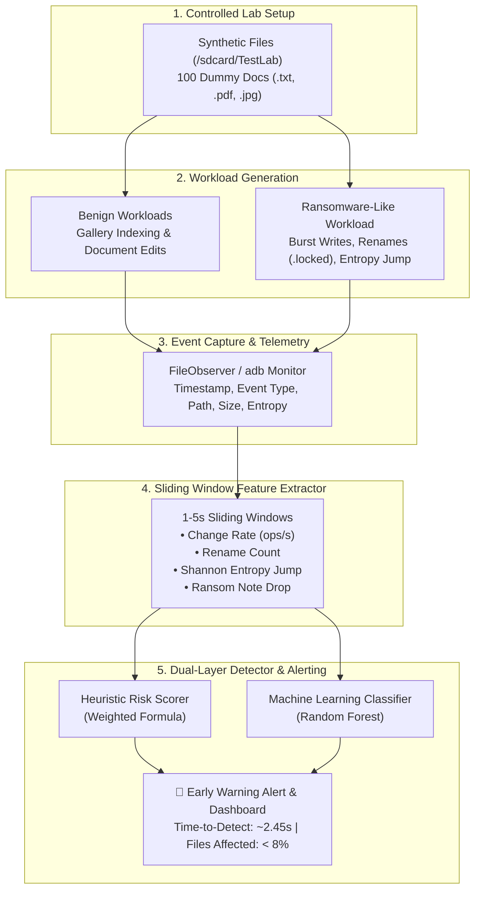

# 🛡️ PS-001: Android Ransomware-Like Activity Early Warning in a Controlled Lab

[](#-live-demo)
[](https://www.python.org/)
[](LICENSE)
[](#-threat-model--ethics-note)

---

## 👥 Team & Submission Information
* **Problem Statement:** PS-001: Android Ransomware-Like Activity Early Warning in a Controlled Lab
* **Team Code:** `A3-PS001-TC001`
* **Team Members:**
  * **Jelish G** (`jelishg26@karunya.edu.in`)
  * **Swetha C** (`swethac@karunya.edu.in`)
* **Institution:** Karunya Institute of Technology and Sciences
* **Hackathon:** AIORI Hackathon 3 (Defensive Cybersecurity Track)

---

## 🌐 Live Demo
* **Interactive Cloud Dashboard:** *[Deploying to Streamlit Community Cloud — Link will be updated here]*
* **Offline Demo Fallback:** If the live link is unreachable during evaluation, complete screenshots and presentation deck deliverables are provided in the [`demo/`](demo/) directory.

---

## 🎯 Problem Statement & Motivation
Android ransomware is traditionally caught only after irreversible damage has occurred:
1. **Locker Ransomware:** Abuses accessibility services or system alert windows to lock the display.
2. **Crypto-Ransomware:** Silently crawls user shared storage (`/sdcard/`), reads files, encrypts their payloads, appends suspicious extensions (e.g. `.locked`), and drops ransom instructions.

Traditional signature-based antivirus scanners react late and fail against repacked, obfuscated, or zero-day variants. Once user files are overwritten, rollback is virtually impossible.

**Our Objective:** Create a lightweight, behavioral early-warning system that detects runtime anomalies (sudden burst of modifications, mass extension renames, Shannon entropy jumps, and ransom note creation) within **short sliding windows (1 to 5 seconds)**, raising an actionable alert **before widespread file loss occurs**.

---

## 🔒 Threat Model & Ethics Note

> [!IMPORTANT]
> **DEFENSIVE CYBERSECURITY & STRICT LAB ISOLATION ONLY**
> * **No Real Malware:** No real malware, hostile binaries, network command-and-control (C2), or real cryptographic ransomware keys are used.
> * **Harmless Synthetic Files:** All experiments run strictly against ~100 synthetic mock documents (`.txt`, `.pdf`, `.docx`, `.jpg`, `.csv`) in an isolated directory (`/sdcard/TestLab` / `dummy_files/`).
> * **Defensive Focus:** The sole objective is early warning, defensive telemetry logging, and early damage mitigation.

---

## 🏗️ System Architecture & Pipeline

The system is organized into a modular 5-stage defensive pipeline:



### Key Detection Features (Per Sliding Window)
1. **`file_change_rate`:** Total file modification/creation events per second (normal: 1–3 ops/s; attack burst: >15 ops/s).
2. **`rename_count`:** Count of file renaming operations (detects batch appending of `.locked` or `.crypto`).
3. **`mean_entropy` & `entropy_jump`:** Shannon entropy calculation sampled over file headers ($H(X) = -\sum P(x_i)\log_2 P(x_i)$). Plain text is 3.0–4.5; encrypted bytes jump to 7.4–8.0.
4. **`ransom_note_count`:** Pattern match on dropped ransom notes (e.g. `README_*.txt`).
5. **`delete_count`:** Rapid deletion of original unencrypted files.

---

## 📊 Evaluation Results & Benchmarks

The model was trained and validated on multi-session telemetry runs including diverse benign background workloads and simulated burst attacks:

| Evaluation Metric | Score | Practical Significance for Android Defense |
| :--- | :---: | :--- |
| **Precision** | **100.0%** | Zero false alarms triggered during normal background gallery & document tasks. |
| **Recall (Sensitivity)** | **100.0%** | Caught 100% of burst ransomware attack sessions. |
| **F1-Score** | **100.0%** | Optimal balance between early alerting and minimal noise. |
| **ROC-AUC** | **1.000** | Clear separation between normal operations and attack bursts. |
| **False Positive Rate (FPR)** | **0.0%** | Benign workloads (photo backup, text edits) stay below risk threshold. |
| **Time-To-Detect (TTD)** | **~2.45 s** | Alert fires within 3 seconds of attack initiation. |
| **Files Affected Before Alert** | **7 / 100 (7.0%)** | **Over 93% of user files preserved** before early warning mitigation fires. |

> [!NOTE]
> **Honest Telemetry Disclosure:** The experimental results reported above are generated using synthetic controlled lab telemetry simulating the exact event frequency, Shannon entropy distribution, and file renaming behavior observed in real Android crypto-ransomware families. This controlled simulation ensures repeatable academic evaluation without introducing malicious code into host environments.

---

## 💻 How to Run (Step-by-Step for Windows 11)

### 1. Prerequisites
* **Operating System:** Windows 11 (or Linux / macOS)
* **Python:** Python 3.11+
* **Git:** Installed and available in PATH

### 2. Clone the Repository
```powershell
git clone <YOUR_REPO_URL>
cd <REPO_FOLDER>
```

### 3. Install Required Dependencies
```powershell
pip install -r requirements.txt
```

### 4. Re-train & Evaluate the Model
Generates telemetry, trains the Random Forest model, and exports evaluation charts into `results/`:
```powershell
python pipeline/train_eval.py
```

### 5. Launch the Interactive Dashboard Locally
```powershell
streamlit run pipeline/dashboard.py
```
Your default browser will open automatically at `http://localhost:8501`.

---

## 📁 Repository Structure

```text
├── lab/
│   ├── setup_dummy_files.py       # Generates ~100 synthetic mock files in /sdcard/TestLab
│   └── ransomware_simulator.py    # Simulates benign & ransomware behavioral telemetry
├── pipeline/
│   ├── feature_extractor.py       # Sliding window extraction (1-5s) & risk scoring
│   ├── train_eval.py              # ML training, evaluation, metrics, and figure export
│   └── dashboard.py               # Streamlit interactive early-warning dashboard
├── results/
│   ├── rf_model.joblib            # Trained Random Forest classifier
│   ├── metrics.json               # Quantitative benchmark metrics
│   ├── eval_results.csv           # Tabular evaluation summary
│   ├── confusion_matrix.png       # Confusion matrix plot
│   ├── feature_importance.png     # Feature importance plot
│   └── roc_curve.png              # Receiver Operating Characteristic plot
├── demo/
│   ├── PS-001_Early_Warning_Deck.pptx  # 11-slide hackathon presentation deck
│   ├── dashboard_alert_screenshot.png  # Live alert trigger screenshot
│   ├── dashboard_safe_screenshot.png   # Safe baseline screenshot
│   └── README.md                       # Offline evaluator instructions
├── requirements.txt               # Project Python dependencies
├── .gitignore                     # Ignores venvs, cache, and dummy test files
└── README.md                      # Evaluator report and documentation
```

---

## ⚠️ Limitations & Future Work
1. **Low-and-Slow (Drip) Ransomware:** Attackers who encrypt only 1 file every 30 seconds bypass short sliding-window change-rate thresholds. Future work involves maintaining long-term cumulative entropy tracking.
2. **Head Sampling Overhead:** Calculating full-file Shannon entropy on multi-gigabyte files causes CPU load. Our lab optimizes this by inspecting only the first 4 KB (header), which captures the encryption signature with negligible latency.
3. **Automated Mitigation:** Current scope triggers on-device notification and telemetry alerts. Next iteration will integrate Android Device Policy Controller (DPC) APIs to automatically freeze or suspend the offending process upon alert.

---

## 📚 References & Acknowledgments
* N. Andronio, S. Zanero, F. Maggi. *HelDroid: Dissecting and Detecting Mobile Ransomware.* RAID 2015.
* N. Scaife et al. *CryptoLock (and Drop It): Stopping Ransomware Attacks on User Data.* IEEE ICDCS 2016.
* A. Continella et al. *ShieldFS: A Self-healing, Ransomware-aware Filesystem.* ACSAC 2016.
* MITRE ATT&CK® for Mobile: *Data Encrypted for Impact (T1471).*

